<div align="center">

<a href="#awesome-remote-access">
  
</a>

# 🚀 Awesome Remote Access

**A definitive, community-curated directory of Remote Desktop Software, High-FPS Game Streaming, Clientless Web Gateways, and Self-Hosted Remote Access Infrastructure.**

<p align="center">
  <a href="https://github.com/ishandutta2007/Awesome-Awesome-Awesome"></a><a href="https://discord.gg/jc4xtF58Ve"></a>
  <a href="https://github.com/ishandutta2007/Awesome-Remote-Access/stargazers"></a>
  <a href="https://github.com/ishandutta2007/Awesome-Remote-Access/network/members"></a>
  <a href="https://github.com/ishandutta2007/Awesome-Remote-Access/blob/main/LICENSE"></a>
  <a href="https://github.com/ishandutta2007/Awesome-Remote-Access/pulls"></a>
  <a href="https://github.com/ishandutta2007"></a>
</p>

<p align="center">
  <b>Search Keywords:</b> Remote Desktop &bull; RDP &bull; VNC &bull; Game Streaming &bull; Moonlight &bull; Sunshine &bull; RustDesk &bull; TeamViewer Alternatives &bull; Self-Hosted Remote Access &bull; WebRTC Remote Control &bull; Zero-Trust Access Gateways
</p>

</div>

---

## 📑 Table of Contents

- [🌐 Sector Overview & Market Dynamics](#-sector-overview--market-dynamics)
- [🏢 SaaS & Hosted Commercial Platforms](#-saas--hosted-commercial-platforms)
- [💻 Open-Source GitHub Projects](#-open-source-github-projects)
- [⚖️ Architecture & Protocol Comparison](#️-architecture--protocol-comparison)
- [🤝 How to Contribute](#-how-to-contribute)
- [⭐ Star History](#-star-history)
- [💖 Support & Sponsoring](#-support--sponsoring)
- [📜 Disclaimer & Security Compliance](#-disclaimer--security-compliance)

---

## 🌐 Sector Overview & Market Dynamics

The global remote desktop and remote access software sector is estimated at **$3.5 billion in 2024 and projected to reach $7.8 billion by 2030**, expanding at a robust compound annual growth rate (**CAGR of ~14.5%–16%**), driven by permanent hybrid work environments, Managed Service Provider (MSP) IT automation, and low-latency cloud gaming/virtual workstation adoption.

The market displays a **moderately concentrated top tier paired with a rapidly expanding, fragmented open-source ecosystem**: established megacap enterprises (Microsoft, Google, TeamViewer, Splashtop) command large corporate contracts and compliance-heavy enterprise IT, whereas high-performance protocols and independent open-source alternatives (RustDesk, Sunshine/Moonlight, Apache Guacamole, MeshCentral) have captured privacy-conscious developers, homelab enthusiasts, and power users seeking to escape recurring subscription fees and commercial-detection popups.

---

## 🏢 SaaS & Hosted Commercial Platforms

The following table benchmarks the leading commercial and hosted remote access solutions. Entries are sorted in **descending order by company size (market valuation or annual revenue)**.

| 🖥️ Product / Service | 🏢 Company & Size (Valuation / Revenue) | 💳 Starting Tier Price | 🎁 Free Tier Limits / Trial Limits | ⚡ Key Features & Highlights |
| :--- | :--- | :--- | :--- | :--- |
| **[Microsoft Remote Desktop / AVD](https://apps.microsoft.com/detail/9wzdncrfj3ps)** | **Microsoft Corporation**<br>📊 Valuation: **$3.12 Trillion**<br>💰 Revenue: $245B+ ARR | **$0.00** included in Windows 10/11 Pro ($199.99 one-time OS purchase); Azure Virtual Desktop starts at **$5.40/user/month** license + consumption compute from ~$0.02/hr | **Free forever plan**: Native RDP client software is 100% free with unlimited sessions for connecting to Windows Pro/Enterprise hosts; Azure Virtual Desktop includes a **30-day free trial** with $200 Azure credits | Native Windows Remote Desktop Protocol (RDP), RemoteFX graphics acceleration, multi-monitor display spanning, local device/audio redirection, and turnkey Azure cloud pooling. |
| **[Chrome Remote Desktop](https://remotedesktop.google.com/)** | **Alphabet Inc. (Google)**<br>📊 Valuation: **$2.15 Trillion**<br>💰 Revenue: $307B+ ARR | **$0.00 / Free Forever** (Zero subscription fees; bundled with any Google Account or Google Workspace) | **Free forever plan**: 100% free with unlimited session duration, up to 100 configured unattended host machines per Google account, and unlimited on-demand remote support codes | Instant browser-based access via WebRTC and VP8/VP9 codecs, zero-install HTML5 client for any browser, lightweight host daemon for Windows, macOS, and Linux. |
| **[Zoho Assist](https://www.zoho.com/assist/)** | **Zoho Corporation**<br>📊 Valuation: **~$15.0 Billion**<br>💰 Revenue: $1.4B+ ARR | **$10.00/technician/month** ($120.00/year billed annually for Remote Support Standard tier; or $12/mo billed monthly) | **Free forever plan**: 1 technician seat, 1 concurrent session, up to 5 unattended host computers, clipboard sharing, and instant chat (non-commercial personal use) | Web-based support console, unattended host management, secure file transfers, multi-monitor navigation, reboot and automatic reconnect, and end-to-end 256-bit AES encryption. |
| **[Parsec](https://parsec.app/)** | **Unity Software Inc. (NYSE: U)**<br>📊 Valuation: **~$9.0 Billion** (Parent Unity Market Cap / $320M Parsec buyout) | **$9.99/month** ($119.88/year billed annually for Parsec Warp; Teams tier starts at **$30.00/user/month**) | **Free forever plan**: Unlimited personal screen sharing and game streaming at 60 FPS, 1 concurrent host stream, and 4:2:0 color sampling | Proprietary ultra-low latency BUD codec, 60–240 FPS rendering, multi-gamepad emulation, virtual display creation, 4:4:4 color accuracy (Warp), and seamless co-op gaming. |
| **[GoTo Resolve](https://www.goto.com/resolve)** | **GoTo (Francisco Partners & Evergreen)**<br>📊 Valuation: **~$4.3 Billion**<br>💰 Revenue: ~$1.3B ARR | **$44.00/month** ($528.00/year billed annually for Remote Support Core tier) | **Free forever plan**: Up to 3 unattended devices, 1 technician agent, remote control, and system diagnostics; or **14-day free trial** for Pro tier (no credit card required) | Zero-trust remote architecture, background terminal access, multi-platform remote control, automated patch scripts, and built-in helpdesk ticketing. |
| **[TeamViewer](https://www.teamviewer.com/)** | **TeamViewer SE (ETR: TMV)**<br>📊 Valuation: **~$2.5 Billion** (€2.3B Market Cap)<br>💰 Revenue: ~€670M ARR | **$24.90/month** ($298.80/year billed annually for Remote Access single-user plan, up to 3 managed computers) | **Free forever plan**: Non-commercial personal use with unlimited sessions (subject to automated commercial-use detection time limits & session prompts); or **14-day commercial trial** | Attended and unattended access, hardware-accelerated remote control, file transfer, wake-on-LAN, multi-monitor switching, and session recording. |
| **[Splashtop](https://www.splashtop.com/)** | **Splashtop Inc.**<br>📊 Valuation: **~$1.0 Billion** (Unicorn status)<br>💰 Revenue: ~$100M+ ARR | **$5.00/month** ($60.00/year billed annually for Business Access Solo, up to 2 computers) | **7-day free trial**: Access up to 2 remote computers with full Business Access capabilities, no credit card required (Splashtop Personal is free on local LAN only) | 4K streaming at 60 FPS, low latency, multi-to-multi monitor support, remote sound, session recording, and granular security permissions. |
| **[AnyDesk](https://anydesk.com/)** | **AnyDesk Software GmbH**<br>📊 Valuation: **~$660 Million** (Series C Valuation)<br>💰 Revenue: ~$55M+ ARR | **$14.90/month** ($178.80/year billed annually for Solo plan, 1 licensed user, 100 managed devices) | **Free forever plan**: Personal non-commercial use only, 1 concurrent connection, up to 3 address book entries (includes cooldown timer and commercial-use warnings) | Proprietary DeskRT codec, ultra-small lightweight client (<5MB), high frame rates on low-bandwidth networks, cross-platform mobile and desktop support. |

---

## 💻 Open-Source GitHub Projects

Explore the top self-hostable remote desktop servers, game stream hosts, clientless web gateways, and secure access bastions. Sorted in **descending order by GitHub Stars_Count**.

1. **[RustDesk](https://github.com/rustdesk/rustdesk)** [](https://github.com/rustdesk/rustdesk/stargazers)  
   **The leading open-source TeamViewer and AnyDesk alternative.** Written in Rust for maximum speed, memory safety, and minimal latency. Features end-to-end encryption, file transfer, real-time chat, clipboard synchronization, and TCP tunneling. Provides a turnkey self-hosted rendezvous and relay server via Docker to ensure total data sovereignty and bypass corporate firewalls. Supports Windows, macOS, Linux (including Wayland multi-monitor scaling), Android, and iOS. *Licensed under AGPL-3.0.*

2. **[Sunshine](https://github.com/LizardByte/Sunshine)** [](https://github.com/LizardByte/Sunshine/stargazers)  
   **The premier open-source game stream host for Moonlight clients.** Originally developed as an open replacement for NVIDIA GameStream, Sunshine offers hardware-accelerated video encoding for AMD (AMF), Intel (QuickSync), and NVIDIA (NVENC) GPUs with minimal glass-to-glass latency. Features a modern web management interface, PIN-based pairing, gamepad rumble, and virtual display drivers. Runs on Windows, Linux, macOS, and FreeBSD. *Licensed under GPL-3.0.*

3. **[NetBird](https://github.com/netbirdio/netbird)** [](https://github.com/netbirdio/netbird/stargazers)  
   **Zero-trust peer-to-peer remote network and machine access engine.** Connects servers, remote workstations, homelab containers, and mobile devices across any NAT or firewall without port forwarding. Built on top of WireGuard with automatic kernel acceleration, SSO/IdP integration (Okta, Azure AD, Google Workspace), MFA, granular access control policies, and an open-source self-hosted management server. *Licensed under BSD-3-Clause.*

4. **[Teleport](https://github.com/gravitational/teleport)** [](https://github.com/gravitational/teleport/stargazers)  
   **Enterprise-grade identity-aware access plane for remote infrastructure.** Provides zero-trust access for SSH servers, Windows Remote Desktop (RDP), Kubernetes clusters, databases, and web applications without VPNs. Includes cryptographic audit logs, session recording with playback, unified RBAC, and seamless integration with existing SSO providers. *Licensed under AGPL-3.0.*

5. **[Moonlight](https://github.com/moonlight-stream/moonlight-qt)** [](https://github.com/moonlight-stream/moonlight-qt/stargazers)  
   **High-performance remote game streaming client.** Pairs directly with Sunshine (or legacy NVIDIA GameStream hosts) to deliver up to 4K resolution at 120+ FPS with HDR support and imperceptible input latency. Available for Windows, macOS, Linux, Steam Deck, Android, iOS, Apple TV, Raspberry Pi, and homebrew consoles. Supports up to 4 local controllers, audio pass-through, and mouse emulation. *Licensed under GPL-3.0.*

6. **[Termix](https://github.com/Termix-SSH/Termix)** [](https://github.com/Termix-SSH/Termix/stargazers)  
   **Self-hosted, plugin-based server and infrastructure management console.** Delivers clientless, browser-based remote access featuring an interactive SSH terminal, background file editing, network tunneling, and hardware metric telemetry. Features an extensible plugin architecture for homelab and production cluster operations. *Licensed under GPL-3.0.*

7. **[noVNC](https://github.com/novnc/noVNC)** [](https://github.com/novnc/noVNC/stargazers)  
   **HTML5 VNC client implemented using WebSockets and Canvas.** Operates smoothly in any modern web browser on desktop or mobile without browser plugins or client installations. Widely integrated into virtualization platforms (such as Proxmox VE, OpenStack, and Kubernetes KubeVirt) to provide direct, embedded remote console access. *Licensed under MPL-2.0.*

8. **[FreeRDP](https://github.com/FreeRDP/FreeRDP)** [](https://github.com/FreeRDP/FreeRDP/stargazers)  
   **The industry-standard free and open-source Remote Desktop Protocol (RDP) implementation.** Powers the underlying RDP capabilities of numerous commercial and open-source applications (including Remmina, Guacamole, and various thin clients). Complies fully with Microsoft RDP specifications, supporting modern TLS/NLA encryption, RemoteFX, multi-monitor layouts, and clipboard/audio redirection. *Licensed under Apache-2.0.*

9. **[Firezone](https://github.com/firezone/firezone)** [](https://github.com/firezone/firezone/stargazers)  
   **Blazing-fast zero-trust remote access gateway.** Built with Rust and WireGuard to replace legacy corporate VPNs. Offers a modern web administrative portal, automated 1-line Docker deployment, split tunneling, multi-factor authentication (MFA), and single sign-on (SSO) integration. Enables secure access to private subnets and internal servers without open incoming ports. *Licensed under Apache-2.0.*

10. **[Warpgate](https://github.com/warp-tech/warpgate)** [](https://github.com/warp-tech/warpgate/stargazers)  
    **Smart SSH, HTTPS, and RDP bastion gateway.** Written in Rust, Warpgate operates as a transparent proxy that works with standard native SSH and RDP clients without special agents. Features session recording, browser-based credential administration, SSO authentication, and per-user protocol routing. *Licensed under Apache-2.0.*

11. **[TigerVNC](https://github.com/TigerVNC/tigervnc)** [](https://github.com/TigerVNC/tigervnc/stargazers)  
    **High-performance, battle-tested Virtual Network Computing (VNC) server and viewer.** Focuses on speed and 3D application performance by leveraging modern JPEG and Tight encoding algorithms. Cross-platform support across Linux, Windows, and macOS, with native X11 integration and robust multi-screen capabilities. *Licensed under GPL-2.0.*

12. **[MeshCentral](https://github.com/Ylianst/MeshCentral)** [](https://github.com/Ylianst/MeshCentral/stargazers)  
    **Complete web-based remote computer management and monitoring suite.** Node.js backend pairs with a lightweight multi-platform daemon (Windows, Linux, macOS, FreeBSD) to deliver browser-based remote desktop control, terminal access, file management, event logs, and Intel AMT hardware-level out-of-band management. Built-in multi-factor authentication, LDAP/Active Directory support, and customizable device permissions. *Licensed under Apache-2.0.*

13. **[xrdp](https://github.com/neutrinolabs/xrdp)** [](https://github.com/neutrinolabs/xrdp/stargazers)  
    **Open-source Remote Desktop Protocol server for Linux and Unix.** Allows standard Windows Remote Desktop Connection clients (MSTSC) or Microsoft Remote Desktop mobile apps to seamlessly connect to Linux desktop environments (GNOME, XFCE, KDE, MATE). Bridges RDP client connections to X11 displays using Xorg or Xvnc backends. *Licensed under Apache-2.0.*

14. **[KasmVNC](https://github.com/kasmtech/KasmVNC)** [](https://github.com/kasmtech/KasmVNC/stargazers)  
    **Next-generation web-native VNC server and client.** Designed specifically for modern web streaming, KasmVNC renders directly to the browser via WebSockets using JPEG, WebP, and H.264 video compression for exceptional frame rates and reduced bandwidth consumption. Includes built-in credential management, audio pass-through, and data loss prevention (DLP) controls. *Licensed under GPL-2.0.*

15. **[Remotely](https://github.com/immense/Remotely)** [](https://github.com/immense/Remotely/stargazers)  
    **Open-source on-demand remote support and unattended access tool for MSPs.** Developed with .NET 8, C#, and Blazor, Remotely allows technicians to initiate quick customer support sessions via a 6-digit code or deploy permanent background agents. Offers remote screen control, interactive PowerShell/Bash scripting, audio streaming, and bidirectional file transfer. *Licensed under GPL-3.0.*

16. **[Nexterm](https://github.com/gnmyt/Nexterm)** [](https://github.com/gnmyt/Nexterm/stargazers)  
    **Open-source server management gateway for SSH, VNC, and RDP.** Features an elegant web console with SFTP file exploration, Proxmox LXC/QEMU integration, two-factor authentication, OIDC single sign-on, and organization-based server partitioning. Runs as a single Docker container. *Licensed under MIT.*

17. **[Apache Guacamole](https://github.com/apache/guacamole-server)** [](https://github.com/apache/guacamole-server/stargazers)  
    **Clientless HTML5 remote desktop gateway.** Guacamole translates standard remote desktop protocols (VNC, RDP, SSH, Telnet) into a native web interface rendered in any HTML5 browser. Because no plugins or agent installations are required on client machines, it is the premier choice for zero-footprint enterprise remote portals and classroom environments. *Licensed under Apache-2.0.*

18. **[Sshwifty](https://github.com/nirui/sshwifty)** [](https://github.com/nirui/sshwifty/stargazers)  
    **Web-based SSH and Telnet terminal connector.** Written in Go and Vue.js, Sshwifty delivers a lightweight, responsive command-line interface directly within any web browser. Features multi-tab session management, WebSockets communication, and containerized deployment. *Licensed under AGPL-3.0.*

19. **[Remmina](https://github.com/FreeRDP/Remmina)** [](https://github.com/FreeRDP/Remmina/stargazers)  
    **The classic GTK+ remote desktop client for POSIX systems.** Supports an extensive range of network protocols including RDP, VNC, SPICE, SSH, and SFTP. Features saved connection profiles, multi-monitor desktop full-screen modes, SSH tunneling, and proxy configuration. *Licensed under GPL-2.0.*

20. **[ShellHub](https://github.com/shellhub-io/shellhub)** [](https://github.com/shellhub-io/shellhub/stargazers)  
    **Modern centralized SSH gateway for edge devices and Linux servers.** Bypasses firewalls and NAT configurations using reverse SSH tunneling. Provides a central web UI for terminal access, cryptographic key management, session audit recording, and fleet grouping. *Licensed under Apache-2.0.*

21. **[Rabbit Remote Control](https://github.com/KangLin/RabbitRemoteControl)** [](https://github.com/KangLin/RabbitRemoteControl/stargazers)  
    **Cross-platform, multi-protocol remote desktop and administration suite.** Unifies VNC, RDP, SSH, TELNET, serial port connections, and FTP/SFTP file transfers under an intuitive desktop client for Windows, Linux, Android, and macOS. *Licensed under GPL-3.0.*

22. **[ScottiBYTE Assist](https://github.com/ScottiBYTE/scottibyte-assist)** [](https://github.com/ScottiBYTE/scottibyte-assist/stargazers)  
    **Self-hosted attended remote assistance system.** Built specifically for technician-to-client ad-hoc helpdesk sessions. Clients connect via a temporary six-digit security code with explicit user permission prompts, protecting client privacy while enabling swift remote troubleshooting without permanent daemons. *Licensed under GPL-3.0.*

---

## ⚖️ Architecture & Protocol Comparison

| Protocol / Stack | Best For | Typical Latency | Web / Clientless Support | Bandwidth Demand | Notable Implementations |
| :--- | :--- | :--- | :--- | :--- | :--- |
| **Sunshine / Moonlight** | 4K 60–120 FPS Gaming & CAD | Ultra-low (&lt;10ms LAN) | Dedicated App Required | High (20–100 Mbps) | Sunshine, Moonlight |
| **RustDesk (Custom Relay)** | General Remote Desktop / Support | Low (15–40ms) | Yes (Web client available) | Medium (2–10 Mbps) | RustDesk |
| **RDP (Remote Desktop)** | Windows Enterprise Workstations | Low (20–50ms) | Via Gateway (Guacamole) | Low to Medium (1–5 Mbps) | Microsoft AVD, FreeRDP, xrdp |
| **VNC (RFB Protocol)** | Homelab & Cross-Platform Linux | Medium (40–80ms) | Yes (noVNC, KasmVNC) | Medium to High (3–15 Mbps) | TigerVNC, noVNC, KasmVNC |
| **WebRTC / DeskRT** | Instant Ad-hoc Remote Support | Low (20–45ms) | Yes (Browser-native) | Adaptive (0.5–5 Mbps) | Chrome Remote Desktop, AnyDesk |
| **WireGuard / Zero-Trust** | Secure Network-Level Access | Ultra-low (&lt;5ms overhead)| Proxy / CLI / Native Apps| Negligible overhead | NetBird, Firezone, Teleport |

---

## 🤝 How to Contribute

Contributions are warmly welcomed! Help expand and refine this ecosystem directory:

1. **Fork the repository** to your personal GitHub account.
2. **Create a new feature branch**: `git checkout -b add-new-remote-tool`.
3. **Add or update an entry** in `README.md`:
   - Follow the established markdown table or numbered list structure.
   - For open-source projects, include the repository URL and a valid social Stars_Badge linked to the stargazers page:
     ```markdown
     **[ProjectName](https://github.com/owner/repo)** [](https://github.com/owner/repo/stargazers)
     ```
   - For commercial/SaaS tools, ensure accurate starting tier pricing and specific free plan/trial limits.
4. **Sort entries properly**:
   - SaaS entries: Sort by company valuation/revenue descending.
   - Open-source entries: Sort by GitHub Stars_Count descending.
5. **Commit your modifications** with a descriptive commit message: `git commit -m "Add <ToolName> to Remote Access list"`.
6. **Push to your branch and open a Pull Request** with a concise explanation.

---

## ⭐ Star History

[](https://star-history.dera.page/#ishandutta2007/Awesome-Remote-Access&type=date&legend=top-left)

---

## 💖 Support & Sponsoring

Thank you for exploring **Awesome Remote Access**! If this curated guide helps you discover the right remote desktop software, save on enterprise subscription fees, or architect an independent self-hosted homelab, please consider supporting the project:

- ⭐ **Star this repository** to improve visibility and help other sysadmins and developers find it.
- 🍴 **Fork and contribute** new tools, protocols, and configuration benchmarks.
- 📢 **Share with your network** on Discord, Reddit, LinkedIn, and X/Twitter.
- ☕ **Sponsor ongoing maintenance & buy a coffee** via the [GitHub Sponsor Dashboard](https://github.com/sponsors/ishandutta2007).

Your sponsorship directly funds testing hardware, cloud benchmarking environments, and continuous maintenance.

---

## 📜 Disclaimer & Security Compliance

- **Community Curated**: This repository is maintained for educational and informational purposes. Mention of a tool or platform does not constitute an official endorsement.
- **Compliance & Privacy**: Remote access software must strictly comply with regional and international data protection laws (such as GDPR, HIPAA, and CCPA). Unauthorized access to computer systems, networks, or connected devices is strictly prohibited by computer crime legislation.
- **Self-Hosting Security**: When deploying self-hosted gateways and relay servers to the public internet, always enforce multi-factor authentication (MFA/2FA), reverse proxies with TLS 1.3 encryption, IP allowlisting, or Zero-Trust Network Access (ZTNA) overlays.
